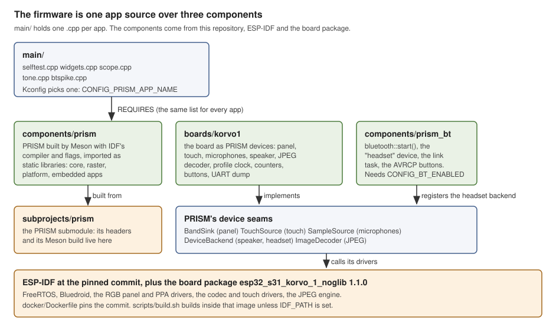
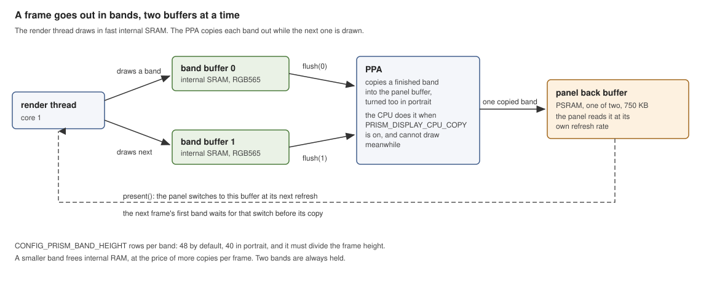
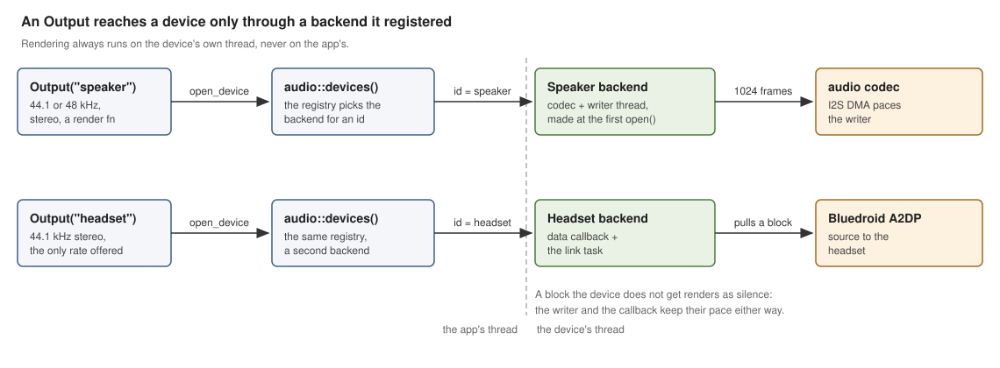

# PRISM on the ESP32-S31-Korvo-1

This repository runs [PRISM](https://github.com/PRISM-GUI/PRISM) on Espressif's
ESP32-S31-Korvo-1 board. You can flash a demo and watch it run without installing ESP-IDF.

It is also the board support for any PRISM app on this board: the panel, the touch, the
microphones, the speaker and the Bluetooth headset are PRISM devices here, and the chip's JPEG
engine is PRISM's image decoder. The MP3 player uses this repository as a submodule.

Start with a demo (next sections, nothing to install), then read "How it is built" if you want to
change something.

## The board

The ESP32-S31-Korvo-1 V1.1 is a development board with:

- two RISC-V cores at 320 MHz,
- 16 MB of flash and 16 MB of PSRAM,
- an 800x480 touch screen (RGB panel, GT1151 touch controller),
- two microphones on an ES8389 audio codec, and a speaker,
- four buttons: SET, MODE, VOLP and VOLM,
- Bluetooth Classic, which this repository uses for A2DP audio.

The screen's frame buffers live in PSRAM, so every app with a panel needs it. Only `selftest` can
run without PSRAM, and it says so.

It has two USB-C ports. Use the one marked UART. The other one only powers the board.

## The six images

Each image is one file, written at address 0.

| Image | What it does | Shows |
|---|---|---|
| `selftest.bin` | Checks PRISM's threads, the SIMD core, the PSRAM, the clocks, the FFT, the profiling. | console only |
| `widgets.bin` | PRISM's widget demo: a counter, a checkbox and a slider. Touch it. | panel |
| `scope.bin` | A scope on the board's microphones: the signal on the left, its spectrum on the right. | panel |
| `tone.bin` | Audio check: lists the devices, decodes a test JPEG, plays 440 Hz at 44.1 then 48 kHz on the speaker, then keeps a tone on the Bluetooth headset. | console only |
| `btspike.bin` | A throwaway spike: Bluetooth audio next to the widget demo, with the internal heap printed every 5 s. | panel + console |
| `crdt.bin` | PRISM's crdt_pair mixer, editable on the panel and from browsers on the board's own Wi-Fi. | panel + browser |

`scope` falls back to a synthetic sweep when the microphones do not start, and says so.

Where to get them:

- A GitHub release has `selftest`, `widgets` and `scope`.
- Every CI run keeps the five it can build as the `firmware` artifact (`crdt` needs PRISM's
  browser build first).
- Or build them yourself (see "Build it yourself"). `crdt` needs PRISM's browser build first: see
  "Edit together: the crdt firmware".

Details per app, and the exact console output: [docs/apps.md](docs/apps.md).

## Flash from the browser

Nothing to install, if the web flasher knows the ESP32-S31. This chip is new: the flasher needs a
version that supports it, and I have not verified that it does. If it fails, use `esptool` (next
section), which is the reliable way. It runs in Chrome or Edge.

1. Plug the board in by its UART USB-C port.
2. Open [Espressif's web flasher](https://espressif.github.io/esp-launchpad/).
3. Connect to the board.
4. Choose the image and set the address to `0x0`.
5. Flash it, then press the reset button.

## Flash with `flash.sh`

You need `esptool` 5.6 or newer, the first release that knows the ESP32-S31
(`pip install "esptool>=5.6"`). If it is missing, the script tells you.

    scripts/flash.sh build/widgets.bin

The script finds the board's serial port by itself. It runs:

    esptool.py --chip esp32s31 -p <port> -b 921600 write_flash 0x0 build/widgets.bin

If it finds two boards, it lists them. Run it again with the port you want:

    scripts/flash.sh build/widgets.bin /dev/ttyUSB1

If it finds none, it asks whether the UART USB-C port is plugged in.

How it finds the port:

- On Linux it looks at `/dev/ttyUSB*` and `/dev/ttyACM*`. It keeps those whose USB bridge is a
  common one (CP210x 10c4:ea60, CH343 1a86:55d3, CH340 1a86:7523, FTDI 0403:6001, 6010 and 6015,
  Espressif's USB serial 303a:1001). Espressif does not say which chip the Korvo-1 uses, so this
  is a list, not a single match. If your board is not found, pass the port yourself.
- On macOS it lists `/dev/cu.usbserial*`, `cu.wchusbserial*`, `cu.SLAB_USBtoUART*` and
  `cu.usbmodem*`. One WCH bridge can show up as both `cu.wchusbserial<N>` and
  `cu.usbserial-<N>`: the script counts it as one board.
- You may need to be in the `dialout` group on Linux.

`scripts/test_flash.sh` checks the script against a fake `esptool`.

## The console at 921600

The board prints on its UART at **921600** baud, for everything. Open any serial terminal:

    picocom -b 921600 /dev/ttyUSB0

Press reset. The first line or two may be garbage. That is the chip's ROM bootloader, which speaks
at 115200.

What you should see:

- `selftest`: one line per check, each ending in `PASS`:

      PRISM self-test on the ESP32-S31-Korvo-1
      std::thread join PASS
      SIMD on core 1 PASS
      snapshot built: N draw commands PASS
      PSRAM: 16 MB PASS
      allocation count: new +1 PASS
      system counters: heap reported, idle grows over 100 ms PASS
      system counters: idle grows by at most 110 ms over 100 ms PASS
      profile clock: 1000000 ticks per second PASS
      fft: 1 kHz sine peaks in bin 64 at -6.0 dB (want 64, -6) PASS
      profile clock never goes back over 1e6 reads PASS
      profile mark on the app_main task PASS
      failures: 0

  It ends with `failures: 0`. A `FAIL` line comes with a hint. The checks are over in about two
  seconds, so the report is printed again every 5 s.
- `widgets`, `scope` and `btspike`: a timing line once a second (update, snapshot, draw and
  present times, and the CPU load).
- `tone`: the device list, the JPEG check, then two playback lines and the headset state.
- `btspike` also prints one heap line every 5 s.

If something is wrong, the line says what to do next. For example
`no PSRAM found: enable CONFIG_SPIRAM, or is this a WROOM-3 module?`.

## Take a trace

`widgets`, `scope` and `btspike` record where the time goes. The recorder lives in PSRAM.

**In the browser (Chrome or Edge, nothing to install):**

1. Flash `widgets.bin` or `scope.bin`, and close any terminal on the port.
2. Open [PRISM trace](https://prism-gui.github.io/PRISM/trace.html), press **Connect** and pick
   the board. Its console appears in the page.
3. Let the demo run for 15 seconds, then press the **MODE** button.
4. When the page says the trace arrived, press **Open in Perfetto**.

The page's summary should say `1000000 ticks/s` and `0 warning(s)`.

**With the command-line tool:**

1. Flash `widgets.bin` or `scope.bin`. Open no terminal on the port.
2. Build `prism-trace` once, from a PRISM checkout (the `io` option must be on):

       meson setup build-trace -Dsdl=disabled -Dio=enabled
       ninja -C build-trace tools/prism-trace/prism-trace

   On macOS with Homebrew's GCC, pick the compiler first:

       CXX=$(ls $(brew --prefix)/bin/g++-1[0-9] | sort -V | tail -1) meson setup build-trace -Dsdl=disabled -Dio=enabled

   Then start it on the port (on macOS the port is `/dev/cu.*`, for example
   `/dev/cu.usbserial-1410`):

       build-trace/tools/prism-trace/prism-trace /dev/ttyUSB0 -o trace.json --baud 921600

3. Let the demo run for 15 seconds.
4. Press the **MODE** button. The screen freezes for a few seconds while the dump drains.
5. The console says `profile: dump done (N bytes)`.

`prism-trace` prints a summary. It should say `1000000 ticks/s` and `0 warning(s)`.
Open `trace.json` in [ui.perfetto.dev](https://ui.perfetto.dev).

## How it is built

One app source, three components, on top of ESP-IDF.

*`main/` holds one `.cpp` per app. The board port, PRISM and the headset component are the three
pieces it builds on.*

| Piece | What it is |
|---|---|
| `main/` | One `.cpp` per app, chosen by Kconfig. |
| `boards/korvo1` | The board as PRISM devices: panel, touch, microphones, speaker, JPEG decoder, profile clock, system counters, buttons. |
| `components/prism` | PRISM, built by its own Meson build with ESP-IDF's compiler and flags, imported as static libraries. |
| `components/prism_bt` | The Bluetooth headset as a PRISM audio device. Compiled only when `CONFIG_BT_ENABLED` is on. |
| `subprojects/prism` | The PRISM submodule: headers and Meson build. |

## The display

PRISM draws each frame in bands. A band lives in the chip's internal SRAM, which is fast, not in
PSRAM. It is drawn directly in RGB565, the panel's own format, so there is no conversion. The PPA
copies each finished band into the panel's buffer while PRISM draws the next one.

*Two band buffers in internal SRAM, and the PPA copying each one out while the next is drawn.*

The band height, the rotation (landscape 800x480, or portrait 480x800), the UI scale and the
pixel clock are Kconfig options of the board component. A smaller band frees internal RAM, which
is what Bluetooth needs. Details and troubleshooting: [docs/display.md](docs/display.md).

## Sound

Two audio devices are registered on this board, and PRISM's `Audio::Output` reaches both through
its backend registry:

- `speaker`: the board's codec, a writer thread that owns it, 44.1 or 48 kHz, stereo, hardware
  volume;
- `headset`: Bluetooth Classic A2DP, 44.1 kHz stereo only, with the headset's own buttons.

*The registry resolves the device id; the device renders on its own thread.*

    prism::esp32::register_speaker();
    prism::esp32::bluetooth::start();      // needs CONFIG_BT_ENABLED

`tone.bin` is the check for both, and its console lines are the expected answers. Contracts,
Kconfig options, error messages and memory notes: [docs/audio.md](docs/audio.md).

## The JPEG decoder

`register_jpeg_decoder()` hands JPEGs to the chip's engine, so covers come from hardware. The
engine decodes to RGB888, PRISM's scaling step takes it to the size and format asked for
(`rgb565` for this panel), and a picture larger than 1600x1600 is refused. The tone app decodes a
64x64 test picture at boot and prints its first pixel: `jpeg: 64x64 rgb565 px0=0xF800`.

More: [docs/jpeg-decoder.md](docs/jpeg-decoder.md).

## Edit together: the crdt firmware

`crdt.bin` runs PRISM's `crdt_pair` mixer on the panel, and the same mixer in a browser. The
board is the hub: it opens its own Wi-Fi network and serves the page, so a phone and a laptop can
join and edit the same model while the panel shows every change.

1. Flash `crdt.bin`.
2. On the phone or the laptop, join the Wi-Fi network `PRISM` (password `prism-crdt`, or whatever
   `CONFIG_PRISM_CRDT_AP_PASSWORD` was set to).
3. Open `https://192.168.4.1`.

The certificate is self-signed and made at build time, so the browser warns once: accept it, and
that is the only warning it gives for this address.

What to look for:

- Move the gain slider or the mode on the panel: the page follows. Change them in the page: the
  panel follows.
- The line under the widgets says how many browsers have joined (up to five).
- Reload the page: it rejoins and catches up, and the panel's count does not grow.

There is no internet: the access point is the board's own, and the board does not join another
network. Nothing is saved: a reboot starts from the model's defaults.

### Build it first

The page is PRISM's `crdt_pair` example built for the browser with emscripten, and the firmware
embeds its three files gzipped. Build that first, in PRISM's checkout:

    meson setup builddir-wasm --cross-file cross/wasm32-emscripten.ini \
        --buildtype=release -Dtests=disabled -Dbenchmarks=disabled -Dcrdt=enabled
    ninja -C builddir-wasm examples/crdt_pair/crdt_pair

Then build this repository's firmware, pointing it at those three files:

    PRISM_CRDT_WEB_DIR=builddir-wasm/examples/crdt_pair scripts/build.sh crdt

That also builds PRISM with its crdt layer (`-DPRISM_CRDT=ON`): the Doc, the sync protocol and
Yrs, the Rust CRDT library, cross-built for this chip by the esp-rs toolchain in the build image.
See [docs/apps.md](docs/apps.md) for the apps in general.

## Troubleshooting

- The board boots, then aborts with `Failed to init external RAM`: this board has no PSRAM.
  Every image with a panel cannot run on it (the screen needs 1.5 MB of PSRAM). Flash
  `selftest.bin` to check: it boots without PSRAM and says `no PSRAM found`.
- Garbage on the console: the baud rate is not 921600 (the ROM bootloader's first line is always
  garbage, at 115200).
- `tone` says `speaker: the speaker's codec did not start`: the codec or the board package is not
  the one this repository expects. The error lines the codec driver prints come just before.
- `tone` keeps printing `headset: Off`: no headset is bonded yet, and nothing was found by name.
  Put the headset in pairing mode the first time. See [docs/audio.md](docs/audio.md).
- A picture that shifts sideways on the panel: PSRAM cannot keep up. See
  [docs/display.md](docs/display.md).
- `crdt`: the page does not load, or it loads and never joins. It has to be `https://192.168.4.1`
  (plain `http` cannot work: the wasm build needs a secure context), with the certificate warning
  accepted. If the page loads and the panel still says no browser joined, the Wi-Fi network was
  joined but the page is open on another address (a bookmark from another network).

## Build it yourself

Docker or Podman is all you need.

    git clone --recursive https://github.com/PRISM-GUI/prism-esp32
    cd prism-esp32
    scripts/build.sh            # everything it can build
    scripts/build.sh widgets    # just one

The images are `build/selftest.bin`, `build/widgets.bin`, `build/scope.bin`, `build/tone.bin`,
`build/btspike.bin` and `build/crdt.bin`.

`scripts/build.sh` on its own leaves `crdt` out, with a note: that firmware embeds PRISM's browser
build, which is a separate build of PRISM with emscripten (see "Edit together: the crdt
firmware"). Everything else needs no extra input.

The script runs in the build image, `ghcr.io/prism-gui/prism-esp32-dev`, tagged `idf-<sha7>`, the
first 7 characters of the pinned ESP-IDF commit in `docker/Dockerfile` (and `latest`). It has
ESP-IDF at the pinned commit. To build the image yourself:

    podman build -f docker/Dockerfile -t ghcr.io/prism-gui/prism-esp32-dev:idf-<sha7> .

If you already have ESP-IDF in your shell (`IDF_PATH` set), the script runs `idf.py` directly.
In that case you also need Meson 1.5 or newer.

The image is `linux/amd64` only. On an Apple-silicon Mac, Docker or Podman runs it under
emulation, which is slow. There, flash the prebuilt images from a release or a CI run, or use a
native ESP-IDF install (set `IDF_PATH`, as above).

The package `ghcr.io/prism-gui/prism-esp32-dev` must be made public once, by the maintainer, after
the first CI publish: the PRISM-GUI organization, Packages, the package, Package settings, Change
visibility (`https://github.com/orgs/PRISM-GUI/packages/container/prism-esp32-dev/settings`).
Until then, others cannot pull it.

Flash from the host, not from the container. USB does not reach a container on macOS.

PRISM is the git submodule `subprojects/prism`. The container sees only this directory, so it must
be the submodule, not a symlink to a checkout elsewhere.

## Use it from your own app

Add this repository as a submodule and add three component directories to your project, where
`PRISM_ESP32` is the submodule's path:

    set(PRISM_ESP32 "${CMAKE_CURRENT_LIST_DIR}/../subprojects/prism-esp32")
    set(EXTRA_COMPONENT_DIRS "${PRISM_ESP32}/boards/korvo1"
                             "${PRISM_ESP32}/components/prism"
                             "${PRISM_ESP32}/components/prism_bt")

Then register what you play on or decode. The settings to carry over, what you do not get, and the
player as a complete example: [docs/integrate.md](docs/integrate.md).

## Add an app to this repository

An app is a model and a view, as on the desktop. This repository only holds the board.

1. Write `main/<name>.cpp` with an `app_main()`. Copy `main/widgets.cpp`: it opens the display
   and the touch, then runs PRISM's `frame_app` on your model. Use `boards/korvo1/app_support.hpp`
   for `halt`, `print_stats` and `open_touch_or_none`.
2. Add a line for it in `main/Kconfig.projbuild` (a `config PRISM_APP_<NAME>` and a
   `default "<name>"` for `PRISM_APP_NAME`).
3. Add `sdkconfig.<name>` with `CONFIG_PRISM_APP_<NAME>=y`. An app that records a profile also
   sets `CONFIG_SPIRAM_ALLOW_BSS_SEG_EXTERNAL_MEMORY=y` (see `sdkconfig.widgets`).
4. Add `<name>` to `apps=(...)` in `scripts/build.sh`.

Then `scripts/build.sh <name>` makes `build/<name>.bin`.

## Tests on the host

Two pieces of the board code are pure logic and are tested without the board: the microphone's
PCM conversion, and the display rotation.

    meson setup host-build host && meson test -C host-build

## Screenshots

Put them in `docs/` and link them here.

- `docs/widgets.jpg`: the widgets demo on the panel.
- `docs/scope.jpg`: the scope, with the spectrum of a whistle.
