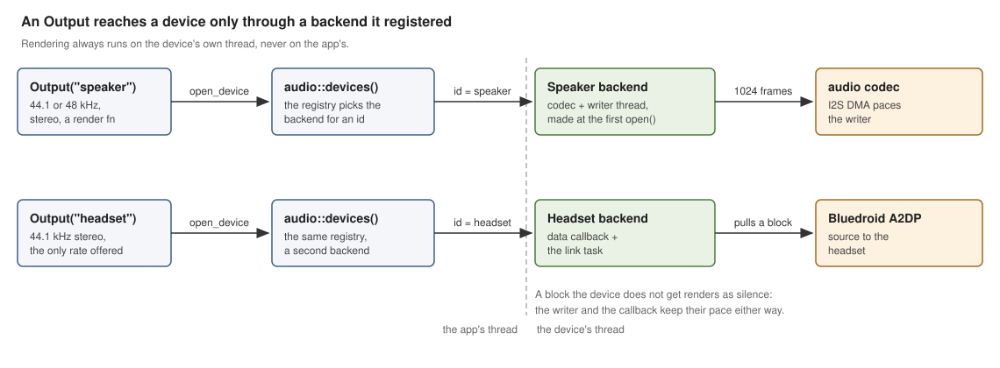

# Sound: the speaker and the Bluetooth headset

PRISM's audio is a registry of devices. A `prism::audio::Output` names a device id, and the
backend that lists that id opens a stream. The board registers two backends: the codec on the
board, and the Bluetooth headset. Both render on their own thread.

*One Output, one backend, one device thread: the registry resolves the id, and the device pulls
blocks from the Output's render function.*

## What an app does

    #include "speaker_device.hpp"          // this repository's board component
    #include <prism/audio/output.hpp>

    prism::esp32::register_speaker();
    prism::audio::Output out{"speaker", {.sample_rate = 44100, .channels = 2}, render};

For the headset, the component is `prism_bt`:

    prism::esp32::bluetooth::start();
    prism::audio::Output out{"headset", {.sample_rate = 44100, .channels = 2}, render};

Both calls are idempotent: the second one finds everything up. Call them once at boot, before
the first Output.

`prism::audio::devices()` then lists what is available. On this board, with both registered:

| id | name | rates | native | default |
|---|---|---|---|---|
| `speaker` | Speaker | 44100, 48000 | s16 | yes |
| `headset` | the connected headset's name, or the configured one | 44100 | s16 | no |

The render function fills one block of interleaved float samples. It runs on the device's
thread, so it must not allocate, block or take a lock. `main/tone.cpp` keeps its phase in the
closure, which is the pattern.

## The speaker

`register_speaker()` registers one backend for the firmware's life. Two things exist in it:

- the codec handle, opened by the first Output at its rate;
- a writer thread, started by the same first `open()`, that owns the codec from then on.

The writer runs for the rest of the boot. Every 1024 frames it asks the attached Output for a
block through a `RenderGate`, writes it to the codec with `esp_codec_dev_write`, and blocks in
the I2S DMA until the codec took it. That block is the pacing: about 23 ms at 44.1 kHz. With no
Output attached the writer writes silence, so the device never starves and the next track starts
on a running codec.

A rate change is a request, not a call. The opening thread stores the wanted rate and waits up
to a second for the writer to reopen the codec at it; only then does the Output say `playing`.
The writer keeps the volume request the same way. The reason is priority: the writer blocks in
the DMA most of the time and, at its higher priority, would take the codec lock back before the
thread asking for a new rate ever got it.

Rules the backend enforces:

- stereo only, 44.1 or 48 kHz only, otherwise `open()` fails and says which;
- one Output at a time: a second attach takes the stream over, and the first Output's samples are
  no longer played;
- `lost()` is always false: the codec is on the board;
- the volume is hardware volume, 0 to 1 from the app, 0 to 100 at the codec.

`main/tone.cpp` is the smoke test: it lists the devices, then plays a 440 Hz tone for two
seconds at 44.1 and again at 48 kHz, and prints how many blocks came and the worst one against
its budget.

## The Bluetooth headset

`components/prism_bt` is the headset as a PRISM device. `bluetooth::start()` brings up the
controller and Bluedroid, registers the `headset` backend, and starts the link task. The
component is compiled only when `CONFIG_BT_ENABLED` is on, because the A2DP headers do not exist
without the stack.

The device:

- offers one rate, 44100 Hz stereo, the one every A2DP source streams;
- takes its name from the headset once known, `Connected to <name>` being the state text;
- reports `lost()` as soon as the link is down. That is the contract to rely on: an Output on a
  connection that went away is lost for good, and its owner makes a new one when the headset
  comes back. `main/tone.cpp` shows the loop;
- scales the volume in the Output instead of sending AVRCP absolute volume. Absolute volume needs
  the peer to register for it, an exchange that cannot be exercised here; scaling works with
  every headset.

The link:

1. The bonded headset is connected first, when there is one.
2. With none bonded, the stack scans for the first device whose name contains
   `CONFIG_PRISM_BT_HEADSET_NAME` (default `WH-1000XM3`, under `Component config` → `prism_bt`).
3. A failed attempt is retried every 3 s, forever.
4. Once connected, the source is acknowledged ready (`CHECK_SRC_RDY`), then the stream is
   started (`START`) as soon as an Output attached a pull.
5. A refused command is retried once, half a second later.

The board is connectable but not discoverable, so a headset that knows it comes back on its own,
while nothing new can pair without the headset's pairing mode. Bonds live in NVS: the component
initialises NVS itself, so a headset is paired once, not once per reset.

### The headset's buttons

`bluetooth::on_remote(handler)` takes a `std::function<void(Remote)>`. `Remote` is
`play_pause`, `next` or `previous`; play, pause and stop all arrive as `play_pause`, and the
volume keys stay the headset's own.

The handler runs on the Bluetooth task. Post to the app's own thread, never touch a UI from
there. `main/tone.cpp` only prints.

Bluedroid's AVRCP target starts with an empty passthrough set and refuses every button as not
implemented until told which it supports, so the component declares play, pause, stop, forward
and backward at bring-up. Nothing is sent back over AVRCP: the app only receives buttons.

### Settings screens

`state_text()` returns `Off`, `Scanning…`, `Connecting…` or `Connected to <name>`.
`state_revision()` changes whenever that text would change: compare the number each frame
instead of building the string and taking a lock.

## Memory

Bluetooth Classic is expensive in internal RAM, and the panel runtime needs a lot of it.

- `CONFIG_BT_ALLOCATION_FROM_SPIRAM_FIRST=y` puts Bluedroid's allocations in PSRAM.
- The link task's 6 KiB stack lives in PSRAM. It calls the Bluetooth API, which only posts to
  the Bluetooth task and reads RAM; ESP-IDF forbids flash access from a PSRAM stack.
- The speaker's writer keeps its stack in internal RAM, because the codec driver may touch
  flash.
- `CONFIG_PRISM_BAND_HEIGHT` trades internal RAM for copies: a smaller band frees some.
  `main/btspike.cpp` prints the internal heap it works with, in one line every 5 s.

## Limitations worth knowing

- One Output per device at a time.
- The speaker plays stereo only; the headset plays 44.1 kHz stereo only.
- The headset's volume is software, so it costs one multiply per sample.
- `btspike` is not a supported path: it hardcodes the headset name and its own handshake.
