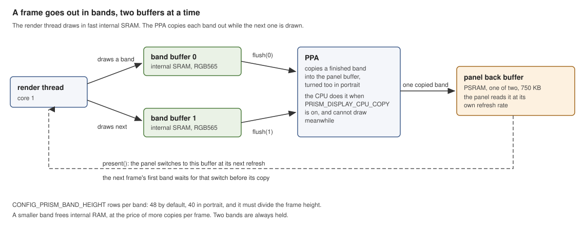

# The panel: bands, PPA and rotation

The Korvo-1 has an 800x480 RGB panel with a GT1151 touch controller. PRISM draws the frame in
horizontal bands, and the board copies each finished band into the panel's own buffer.

*Two band buffers in internal SRAM, the PPA copying each into the panel buffer while the render
thread draws the next band.*

## Why bands

A full 800x480 RGB565 frame is 750 KB. Two of them live in PSRAM, owned by the panel driver, and
PRISM never draws into them directly: PSRAM is slow, and a band that lives in internal SRAM is
written at full speed.

1. The render thread asks `band(i)` for a buffer that is free, and draws
   `CONFIG_PRISM_BAND_HEIGHT` rows of RGB565 into it (48 by default). RGB565 is the panel's own
   format, so there is no conversion.
2. `flush(i, first_row, rows)` starts the PPA copying that band into the panel's back buffer and
   returns.
3. The render thread draws the next band into the other buffer while the copy runs.
4. `band(i)` again waits for that buffer's previous copy.
5. `present()` hands the back buffer to the panel, which switches to it at its next refresh.

The first band of the next frame waits for that switch before its copy: only then has the panel
stopped reading the buffer it writes into. `frame_age()` returns 2, so the buffer being drawn
into still shows the frame before last.

## Options

All of them are in `boards/korvo1/Kconfig`, under "PRISM on the Korvo-1".

| Option | Default | What it does |
|---|---|---|
| `CONFIG_PRISM_BAND_HEIGHT` | 48 (40 turned) | Rows per band, 8 to 96. Must divide the frame height: 480 in landscape, 800 in portrait. A smaller band frees internal RAM for Bluetooth at the price of more copies per frame. |
| `CONFIG_PRISM_DISPLAY_ROTATION` | landscape | Landscape 800x480, or portrait 480x800 with the board turned either way. |
| `CONFIG_PRISM_DISPLAY_CPU_COPY` | off | Copy the bands on the CPU instead of the PPA. The fallback if the PPA misbehaves: it is slower, and the render thread cannot draw meanwhile. |
| `CONFIG_PRISM_LCD_PCLK_MHZ` | 18 | The panel's pixel clock, 1 to 40 MHz. The board package's own value is 18. |
| `CONFIG_PRISM_UI_SCALE_PERCENT` | 150 | The UI scale of the panel apps, 100 to 300. A finger is bigger than a pointer. |

The UI scale lives in the board component, not in `main/`, so an app outside this repository
gets it too. `boards/korvo1/app_support.hpp` reads it in `pinned_threads()`.

## Portrait

With a rotation set, the frame PRISM draws is 480x800. Each band is 480 pixels wide, and the PPA
turns it as it copies, into a run of the panel's columns. The CPU fallback turns it too. Touch
points are turned the same way, so the apps keep drawing in their own frame.

The band height must then divide 800, which is why the default drops to 40 when the board is
turned.

## When the picture is wrong

- A picture that shifts sideways: PSRAM cannot keep up with the panel. First try bounce buffers
  (`CONFIG_BSP_LCD_RGB_BOUNCE_BUFFER_MODE=y`) instead of `CONFIG_BSP_LCD_RGB_REFRESH_AUTO=y`,
  then a lower pixel clock.
- `Failed to init external RAM` at boot: this board has no PSRAM. The screen needs it.
- `BandDisplay::open()` returning an error: the message says what failed, and the app prints it on
  the console and stays there, so the line can be read.

## The trace recorder

`widgets`, `scope` and `btspike` record where the time goes. PRISM's global recorder is 768 KiB
of zero-initialised data, more than the internal RAM has left, so `boards/korvo1/linker.lf` puts
it in PSRAM. That is why those apps set `CONFIG_SPIRAM_ALLOW_BSS_SEG_EXTERNAL_MEMORY=y`.

Press MODE to dump it on the console UART at 921600 baud. See "Take a trace" in the
[README](../README.md).
