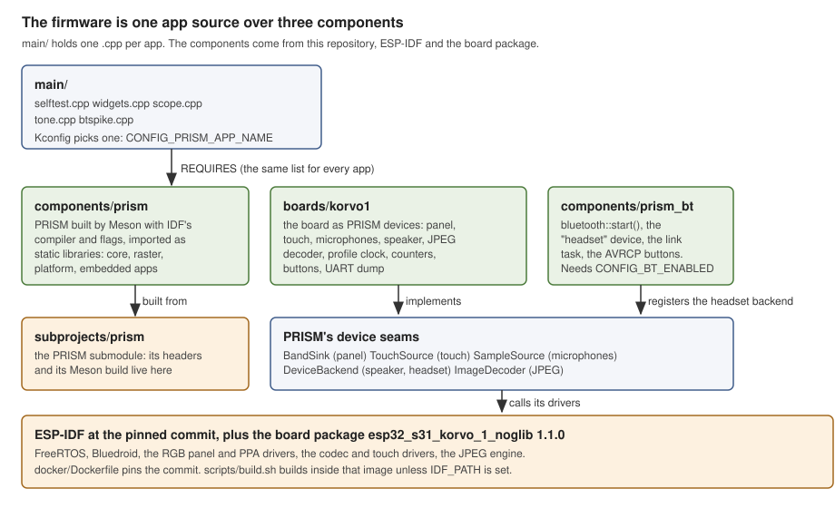

# Use this repository from another app

This repository is not only six demos. It is the Korvo-1 board support for any PRISM app on
that board: the display, the touch, the microphones, the speaker, the Bluetooth headset, the
profile clock and the JPEG decoder.

*One app source over three components: PRISM built by Meson, the board port, and the headset.*

The player is the example: `prism-mp3-player` holds `prism-esp32` as a submodule at
`subprojects/prism-esp32`.

## Layout

    my-app/
      subprojects/
        prism-esp32/          # this repository, with its own PRISM submodule
      boards/korvo1/
        CMakeLists.txt
        main/
          CMakeLists.txt
          app_main.cpp
        sdkconfig.defaults

## The CMake

The project file adds three component directories from the submodule, then declares the project:

    set(PRISM_ESP32 "${CMAKE_CURRENT_LIST_DIR}/../../subprojects/prism-esp32")
    set(EXTRA_COMPONENT_DIRS "${PRISM_ESP32}/boards/korvo1"
                             "${PRISM_ESP32}/components/prism"
                             "${PRISM_ESP32}/components/prism_bt")
    include($ENV{IDF_PATH}/tools/cmake/project.cmake)
    project(player)

Your app component requires the ones it uses:

    idf_component_register(
        SRCS app_main.cpp
        REQUIRES prism korvo1 prism_bt freertos pthread nvs_flash esp_driver_jpeg
    )

Require `prism_bt` even when the app is built without Bluetooth: with `CONFIG_BT_ENABLED` off the
component compiles no sources, and its header is harmless.

## Register what you use

    prism::esp32::register_speaker();
    prism::esp32::register_jpeg_decoder();
    #if CONFIG_BT_ENABLED
    prism::esp32::bluetooth::start();
    #endif

All three are idempotent. Call them once at boot, before the first Output and before the first
image. Then play on the `speaker` or `headset` device like on any other PRISM platform: see
[audio.md](audio.md) for the contracts, [jpeg-decoder.md](jpeg-decoder.md) for the decoder.

For the panel, `korvo1::BandDisplay::open()` is the frame's BandSink, and
`korvo1::open_touch_or_none()` is its input. `korvo1::pinned_threads()` gives the runtime this
board's options: logic on core 0, render on core 1, the UI scale.

## The configuration to carry over

Start from this repository's `sdkconfig.defaults` and keep these, or the board misbehaves in
ways that look like app bugs:

- `CONFIG_IDF_TARGET="esp32s31"` and a 16 MB flash.
- `CONFIG_SPIRAM=y`, plus `CONFIG_SPIRAM_MALLOC_ALWAYSINTERNAL=256`: PRISM makes thousands of
  small allocations, and the internal heap has to survive them.
- `CONFIG_PARTITION_TABLE_CUSTOM=y` with a 3 MB app partition (`partitions.csv`).
- `CONFIG_COMPILER_CXX_EXCEPTIONS=y`, `CONFIG_COMPILER_CXX_RTTI=y`, and
  `CONFIG_COMPILER_OPTIMIZATION_PERF=y`: PRISM draws on the CPU.
- `CONFIG_ESP_CONSOLE_UART_BAUDRATE=921600`.
- `CONFIG_ESP_MAIN_TASK_STACK_SIZE=32768`, `CONFIG_PTHREAD_TASK_STACK_SIZE_DEFAULT=16384`.
- `CONFIG_HEAP_USE_HOOKS=y` and the FreeRTOS run-time counters, for the timing line.
- `CONFIG_PRISM_LCD_PCLK_MHZ=18` and `CONFIG_BSP_LCD_RGB_REFRESH_AUTO=y`.

For an app with Bluetooth, add what `sdkconfig.tone` sets: Classic only, Bluedroid, A2DP and
AVRCP on, BLE off, and `CONFIG_BT_ALLOCATION_FROM_SPIRAM_FIRST=y`.

For an app with the panel and Bluetooth together, `CONFIG_PRISM_BAND_HEIGHT=16` is what the
player uses: internal RAM is the scarce one, and the bands are the lever. See
[display.md](display.md).

## What you do not get

- The app choice. `main/Kconfig.projbuild` and the `sdkconfig.<app>` files belong to this
  repository's six demos; your app has its own `main/`.
- The build script. `scripts/build.sh` builds the demos in this repository's `main/`. Use your
  own `idf.py` invocation, merge the image with `esptool merge-bin`, or copy the script's last
  step.
- A guarantee on the board options. `boards/korvo1/Kconfig` is the shared part: band height,
  rotation, UI scale, pixel clock and the CPU copy. Everything else is yours.

## Pinning and updating

`prism-esp32` in the parent repository is a submodule, and `subprojects/prism` inside it is
another. `git submodule update --init --recursive` gets both. Moving `prism-esp32` forward moves
PRISM and the board port together, which is the combination that was built and flashed here.
